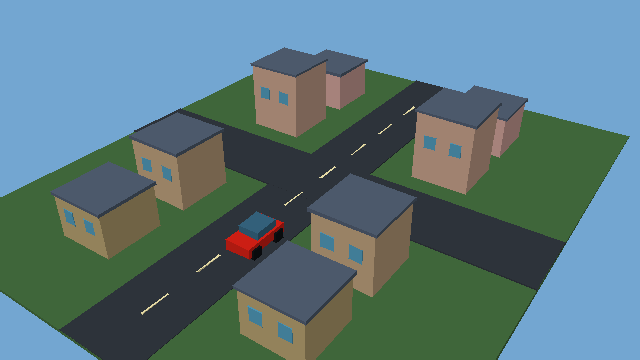

# A genuinely free route to a GTA-style game

## Conclusion

There is a credible zero-software-cost route to an **original, modest 3D city game with GTA-like mechanics**: use an engine suited to the available hardware, run a small visible/simulated part of the world at once, and use simple original or licensed assets. This is not evidence that a GTA V/VI-scale production with comparable visual detail will run well on an i3-5005U/Intel HD 5500 laptop.

The laptop already has a GPU: the Intel HD 5500 is integrated graphics. “No dedicated GPU” is not “no graphics hardware.” Godot's official requirements allow integrated graphics, and its Compatibility renderer targets OpenGL 3.3-class hardware. Driver and operating-system support still need checking. [1](https://docs.godotengine.org/en/4.4/about/system_requirements.html)

This research examines the main practical routes, not every product or temporary promotion on the internet. The recommendation is an engineering assessment, not a laptop benchmark.

## Routes compared

| Route | Cost/availability evidence | Assessment for this project |
|---|---|---|
| **Godot, Compatibility renderer** | MIT-licensed, no engine royalties; integrated graphics supported by its requirements. [3](https://docs.godotengine.org/en/stable/about/introduction.html) [1](https://docs.godotengine.org/en/4.4/about/system_requirements.html) | Preferred standalone-game/editor route. Start with a deliberately small graphics and simulation budget. |
| **Panda3D, Python, hardware graphics on the laptop** | Free, open-source BSD engine with Python/C++ APIs. [1](https://www.panda3d.org/) | Strong alternative for an AI-controlled Python workflow; more game/editor tooling must be implemented or assembled. |
| **Panda3D TinyDisplay in the sandbox** | Officially includes a software-rendering plugin. [2](https://docs.panda3d.org/1.10/python/distribution/building-binaries) | Actually tested here for CPU-only static 3D output. Useful for automated visual checks, not evidence of GTA-grade real-time performance. |
| **Babylon.js / browser game** | Free, open-source browser engine using WebGL/WebGPU. [1](https://www.babylonjs.com/) | Good for a shareable prototype. Choose a compatible graphics backend and test the laptop's browser; a browser does not supply stronger hardware. |
| **Unity Personal** | Free for eligible users under its applicable financial thresholds; Unity supports DX10/11/12/Vulkan-class graphics on Windows. [5](https://docs.unity.com/cloud/billing/unity-cloud-pricing-model) [3](https://docs.unity.com/en-us/engine/6000.0/manual/get-started/install-and-upgrade/getting-started-installing-unity/system-requirements) | Possible alternative, but licensing/account setup and editor overhead are additional considerations. Not my first choice for this constrained automated setup. |
| **Roblox Studio** | Free Windows/Mac creation tool; published minimum is 3 GB RAM, recommended 8 GB. [1](https://create.roblox.com/docs/tutorials/curriculums/studio/install-studio) | A platform-based city/driving game is another candidate. The official editor must be tested on the user's machine; this is not the same standalone-export workflow as Godot/Panda3D. |
| **Unreal 4.27 or reduced-feature UE5** | UE4.27 has lower published Windows RAM recommendations than modern UE5; UE5 scalability can disable Lumen. [1](https://dev.epicgames.com/documentation/en-us/unreal-engine/hardware-and-software-specifications?application_version=4.27) [1](https://dev.epicgames.com/documentation/en-us/unreal-engine/lumen-performance-guide-for-unreal-engine) | Not impossible merely because graphics are integrated, but not verified or recommended as the reliable starting point on this laptop. Disabling features does not remove all editor, graphics, CPU, storage, and license constraints. |
| **Free GitHub CPU workflows** | Standard hosted runners are free for public repositories; Godot can export from a headless CLI. [1](https://docs.github.com/en/billing/concepts/product-billing/github-actions) [2](https://docs.godotengine.org/en/latest/tutorials/editor/command_line_tutorial.html) | Useful for building, packaging and logic tests. Headless success does not certify visible graphics or laptop FPS. Artifact/storage/security limits still apply. |
| **GitHub GPU runners** | GPU-powered larger runners are billed and have plan eligibility restrictions, including for public repositories. [1](https://docs.github.com/en/billing/reference/actions-runner-pricing) | Not a zero-budget solution we can assume is available. |
| **Free GPU notebooks** | Colab explicitly does not guarantee GPU availability, runtime or unlimited resources, and restricts some uses of free managed runtimes. [1](https://research.google.com/colaboratory/faq.html) | Not a dependable, permanently available Unreal development workstation. Do not bypass usage restrictions or quotas. |
| **Software graphics instead of a GPU** | Panda3D includes TinyDisplay; Microsoft documents WARP as a CPU rasterizer with performance limitations. [1](https://docs.panda3d.org/1.10/python/programming/configuration/configuring-panda3d) [1](https://learn.microsoft.com/en-us/windows/win32/direct3darticles/directx-warp) | Can make genuine 3D output possible for some workloads. It is not a general promise of fast UE5, modern shaders, or a large real-time city. |

Trial credits, competitions, donated machines and institution-provided hardware may help individuals, but none has been established as available to this user. They are not the baseline plan, and no paid resources were provisioned.

## Actual no-GPU proof executed here

I installed Panda3D **1.10.16** from PyPI in the local virtual environment and executed a small native 3D scene using:

- `TinyOffscreenGraphicsPipe`
- `TinyGraphicsStateGuardian`
- CPU-only off-screen rendering at **640×360**
- Primitive buildings, a road intersection, window geometry and a simple car
- Image readback, dimensions and nonempty-image checks

**Result: CPU_ONLY_3D_COMPATIBILITY_PROOF_PASS.** This was an actual engine render, not an image-generation substitute. No GPU allocation, cloud GPU purchase or new GitHub workflow was used.



Reproduction:

```bash
python -m venv .venv
.venv/bin/pip install panda3d==1.10.16
.venv/bin/python tools/free_game_cpu_probe.py
```

The script writes a PNG and a JSON record under `docs/research-assets/`. Panda3D is an optional research dependency, not added to the Blender production requirements.

**Not demonstrated:** interactive gameplay, physics, traffic, police AI, missions, a large world, laptop FPS, photorealistic graphics or any Unreal execution. The proof establishes a working CPU-only graphics path in this sandbox, nothing more.

## A practical zero-budget architecture

My first recommendation is **Godot Compatibility + Blender assets + a small native Windows build**. Panda3D is the alternative when direct Python automation and software-rendered sandbox checks are the priority. Both require actual gameplay implementation and testing, not just installing an engine.

Suggested initial target—not a measured performance claim:

- 1280×720, adjustable downwards; start with a 30 FPS target.
- One original neighbourhood, initially one street and one intersection.
- A third-person character, camera, collision and one controllable vehicle.
- One simple delivery/checkpoint mission before adding more systems.
- A small tunable number of nearby vehicles and pedestrians.
- Simple materials, restrained lighting and limited shadow distance.
- Separate quality options for shadows, resolution and population.

Then expand using world cells, distance-based spawning, simple distant representations and level of detail. A procedurally large map is not the same thing as simulating and rendering the entire city. Godot documents LOD, visibility ranges, instancing and culling as performance tools; the benefit must be measured rather than assumed. [1](https://docs.godotengine.org/en/latest/tutorials/performance/optimizing_3d_performance.html)

Use the integrated GPU for visible gameplay on the laptop where its drivers support the chosen renderer. Use CPU workflows for generation, tests and exports. Software previews in the sandbox are for correctness and inspection, not substitutes for playtesting on the target laptop.

### Lighting caveat

Do not casually promise native Godot 4 lightmap baking on a GPU-less runner. Its native lightmapper uses GPU compute, and lightmap baking is not available in the Compatibility renderer even though rendering existing lightmaps is supported. For this free CPU-only production path, alternatives include simple direct lighting, vertex colors, or carefully prepared texture/AO bakes from Blender CPU workflows, with their own visual compromises. [2](https://docs.godotengine.org/en/latest/engine_details/architecture/internal_rendering_architecture.html)

## Free starting resources verified

- Kenney **City Kit (Roads)** and **City Kit (Commercial)** list free downloads under CC0. [1](https://kenney.nl/assets/city-kit-roads) [3](https://kenney.nl/assets/city-kit-commercial)
- Kenney **Car Kit** also lists a free CC0 download. [1](https://kenney.nl/assets/car-kit)
- Godot's **Truck Town** demonstrates vehicle physics with MIT project code. It is not a GTA framework. The current source I inspected declares Forward+ rendering and a newer engine feature version, so do not assume it is ready for the proposed Compatibility build. Pin and adapt a suitable version; audit separately credited assets before redistribution. [1](https://godotengine.org/asset-library/asset/2752)
- Inspected source and license directly through GitHub: https://github.com/godotengine/godot-demo-projects/tree/master/3d/truck_town and https://github.com/godotengine/godot-demo-projects/blob/master/LICENSE.md .

Use original names, maps, missions and characters. An open-source engine or reverse-engineered game project does not grant rights to Rockstar's maps, recordings or other commercial assets.

## Acceptance gates before expanding

1. Confirm the laptop's OS, RAM, graphics driver and supported graphics API.
2. Build a tiny native executable with a third-person character and car.
3. Test it on the actual laptop; capture frame time, memory and stability, not just average FPS on a different machine.
4. Establish a measured graphics/physics/population budget.
5. Add one mission and save/load; then small traffic and wanted-state systems.
6. Expand the map only while profiling remains acceptable.

I can implement source code, models, automation and test exports in the available development environment. The user does not need to learn GPU setup, but target-device testing is necessary; the sandbox cannot certify their laptop's performance remotely.

## Decision

**Yes to an original, lightweight 3D GTA-style prototype using free software and existing hardware.** The new technical finding is that Panda3D also supplies a working Python-controlled CPU-only visual test path here. Godot remains a strong standalone-editor choice.

**Not established:** a free dependable high-end cloud GPU allocation, a reliable UE5 cinematic workstation in this sandbox, or a GTA V/VI-equivalent game at comparable fidelity on the stated laptop. No legitimate configuration file or extra workflow can guarantee that hardware performance.
