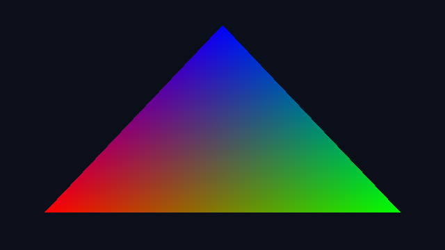
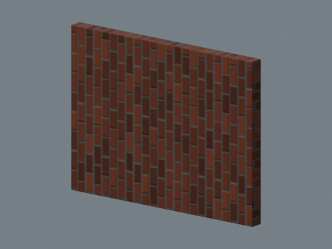

# Audit: software GPU, a Blender game engine, and realistic game assets

## Bottom line

**There is a constructive, zero-additional-paid-resource route:** use Blender/`bpy` as an automated asset factory, bake expensive material detail on the CPU, and use an existing game engine for gameplay. Use Mesa software graphics for compatibility checks and bounded previews—not as a promise of free GPU acceleration.

This audit deliberately does **not** constrain the project to your laptop. It separates what the project can be built with from where its final real-time performance must be measured.

| Your idea | Answer | Evidence level |
|---|---|---|
| Create a virtual GPU | **Software graphics: yes, actually enabled here.** Hardware-backed vGPU: needs actual GPU resources. | Mesa OpenGL 4.5 raster and compute shaders passed; actual Blender Eevee render passed on CPU. |
| Build an engine on `bpy` | Possible, but `bpy` alone is not a shipping game runtime. **UPBGE already implements the Blender-integrated-engine approach.** | Official UPBGE documentation researched; UPBGE itself not installed or benchmarked. |
| Make realistic Blender assets for Godot/Unity | **Yes: this is the strongest production route.** Asset quality and runtime optimization must be developed together. | CPU texture baking, GLB/FBX export, GLB structure and Blender reimport verified. Godot/Unity imports remain untested. |
| Turn these proofs into GTA | **Not established.** Realism, gameplay, city content and stable frame times are separate acceptance gates. | No GTA-scale scene, game loop, NPC population, traffic system or playable build was tested. |

No new CI workflow, paid compute, or production-render change was used for this audit. The original Alpine scene, production requirements and render workflows were not modified. This report makes no new assertion about that separate render's completion.

## 1. What we actually made and tested

### A. A genuine software OpenGL stack

The earlier Panda3D TinyDisplay proof established primitive CPU 3D. This new test goes further: it uses **real Mesa libraries, EGL, an OpenGL context, compiled GLSL shaders and a compute shader**. No fake GPU libraries, dummy device IDs or stub rendering functions are involved.

Measured results:

- Renderer: **`llvmpipe (LLVM 15.0.6, 256 bits)`**.
- API: **OpenGL 4.5 Core Profile, Mesa 22.3.6**.
- A 640 × 360 color-interpolated triangle was rasterized with vertex/fragment shaders and read back to PNG.
- An OpenGL compute shader squared **256 values**; every output was checked against the CPU reference.
- The reported maximum texture dimension was 16,384. That is an API limit, **not** a practical texture-memory budget.
- All graphics work was executed on the **CPU**; no physical GPU was added.

Evidence: [machine-readable results](research-assets/software-opengl-proof.json), [rendered image](research-assets/software-opengl-proof.png), [`tools/audit_software_graphics.py`](../tools/audit_software_graphics.py).



**Important correction to the initial environment audit:** graphics libraries were initially absent. They are now available to the audit's explicitly configured child processes through a local cache. They were not installed system-wide.

### B. Blender Eevee really rendered through that stack

We installed the actual PyPI **`bpy==4.2.23`**, with proper X/GL dependencies, then rendered the baked-material test asset with **`BLENDER_EEVEE_NEXT`**. Blender's own `gpu.platform.renderer_get()` reported **llvmpipe**.

- Actual PNG: **480 × 360**, 64 samples.
- First observed render: approximately **41.55 seconds** including cold shader work.
- Final recorded repeat: **27.009 seconds** for one still.
- The image was opened and visually inspected, not merely checked for file existence.
- The Eevee worker exited normally with status 0.



This is a deliberately simple **material/export proof**, not photoreal art. The pictured wall does not meet a GTA-quality environment brief.

A sampled still-render time is **not an interactive FPS benchmark**. Nevertheless, it makes the trade-off visible: software graphics unlocks real functionality, but does not establish inexpensive real-time rendering.

### C. An actual baked asset, not just an export recommendation

Created an original, small 4 m × 3 m wall asset with bevels and procedural brick material. Then:

1. Applied scale and geometry modifiers; generated UVs.
2. Used **Cycles CPU** to bake a 512² base-color image and a 512² tangent-space normal map.
3. Replaced the procedural material with image-based Principled PBR: base color, normal map and a roughness factor.
4. Exported **GLB** with embedded images, normals, UVs and tangents; exported **FBX** with embedded textures.
5. Parsed the GLB header/material/mesh data and checked its embedded textures.
6. Reimported the GLB in a separate Blender process and checked mesh count, UVs, material count and physical dimensions.
7. Loaded the packed `.blend` and produced the software-Eevee preview above.

Results: **108 triangles**, one material, two embedded GLB images; GLB **164,696 bytes**, FBX **173,580 bytes**.

Files:

- [Editable packed Blender file](research-assets/game-ready-wall/wall.blend).
- [GLB asset](research-assets/game-ready-wall/wall.glb).
- [FBX asset](research-assets/game-ready-wall/wall.fbx).
- [Base-color texture](research-assets/game-ready-wall/wall_basecolor.png) and [normal map](research-assets/game-ready-wall/wall_normal.png).
- [Proof manifest, hashes and limitations](research-assets/game-ready-wall/proof.json).
- [Reproduction script](../tools/audit_blender_game_asset.py).

**This verifies asset generation and interchange data—not native Godot/Unity import, matching lighting, or a production-ready game asset pack.** No collider/LOD/streaming or gameplay acceptance gate is marked complete.

### D. A real failure found during the audit

The embedded `bpy` CPU-bake worker repeatedly produced and validated its outputs, then **SIGSEGV'd during native finalization**. Separating reimport did not remove the issue. Testing NumPy 2.4.6 versus 1.26.4 and calling Blender's quit operator did not fix it.

The bounded proof therefore uses an **explicit, disclosed process-boundary workaround**: only after successful assertions and closed file writes, the short-lived bake worker flushes output and exits directly, bypassing native/interpreter cleanup. Any earlier exception remains a failure. Separate reimport and Eevee workers use normal shutdown and both completed successfully.

The manifest explicitly records `integration_stability_proven: false` and a qualified success status. **This workaround does not count as fixing Blender's native cleanup bug or proving a stable embedded game engine.** A production pipeline should test an official standalone Blender executable and/or resolve the embedded-module issue before relying on a long-lived `bpy` service.

Additional nonfatal diagnostics: Blender's glTF exporter reported unavailable optional Draco compression; this asset uses uncompressed core glTF and its mesh data was checked. Eevee emitted an EGL_BAD_MATCH diagnostic during context setup, then rendered successfully and confirmed llvmpipe. These warnings were not mistaken for proof that every graphics configuration works.

## 2. Virtual GPU: what is and is not possible

### Hardware-backed virtualization

NVIDIA vGPU, GPU passthrough and MIG expose/share/partition **real physical GPU resources**. NVIDIA explicitly requires a supported GPU and suitable host/hypervisor. Software cannot allocate hardware compute that the host does not have. [1](https://docs.nvidia.com/vgpu/latest/pdf/grid-vgpu-user-guide.pdf)

The initial sandbox audit found no `/dev/dri`, `/dev/nvidia0` or `/dev/kvm`. Creating a virtual display, advertising more VRAM, installing a driver, or adding a container would not change that finding into hardware acceleration.

### Software graphics — the part of your idea that works

Mesa llvmpipe compiles graphics operations into CPU machine code, including shaders, vertex processing and rasterization. That is why a graphics API can work without a GPU. We tested that implementation rather than writing a new rasterizer/compiler from scratch. [1](https://docs.mesa3d.org/drivers/llvmpipe.html)

For Vulkan, SwiftShader is a CPU-based implementation and is a credible follow-up candidate. **It was researched, not installed or tested here.** OpenGL success must not be promoted into Vulkan or Unreal success. [3](https://github.com/google/swiftshader/tree/master?search=1)

**Useful:** material/API tests, automated screenshots, some editor/render compatibility work and small software-rendered applications.

**Not established:** CUDA/OptiX, hardware ray-tracing throughput, Unreal operation, fast 1080p gameplay, or GTA-scale real-time rendering. An OpenGL compute shader running on the CPU is not a new CUDA device.

**Decision:** keep the working Mesa layer for testing. Do not spend the project building a GPU emulator or a VM stack to obtain performance; that would add implementation work without adding physical compute.

## 3. A game engine built around Blender

### `bpy` versus a runtime

`bpy` excels at generating/editing scenes, building materials, baking, rigging, exporting and production automation. Timers or repeated renders can animate a demonstration, but do not by themselves supply a deployable game loop with input, fixed-step physics, streaming, navigation, save state, audio, profiling and packaging.

Blender's Python integration is also not generally thread-safe. Concurrent game/asset worker threads cannot casually mutate `bpy` data. Use supported main-thread operations or separate processes. The documented threading warning is independent of the native cleanup failure discovered above; we have not established that threading caused that failure. [1](https://docs.blender.org/api/current/info_gotchas_threading.html)

### UPBGE already implements this approach

UPBGE is a Blender-derived, integrated game engine. Its documentation describes EEVEE rendering/PBR, Python logic, Bullet physics, audio, viewport play and standalone execution. This is much closer to your request than trying to turn an ordinary PyPI `bpy` wheel into a new engine. [1](https://upbge.org/docs/latest/manual/manual/introduction/briefing.html)

- Blender integration does not eliminate the cost of rendering a scene.
- Runtime game APIs/logic are not simply interchangeable with every authoring-side `bpy` operation.
- A specific UPBGE version must be selected and its supported features/export/distribution requirements checked.
- **UPBGE has not been installed, played, packaged or benchmarked in this audit.** Our Blender Eevee result is not an UPBGE compatibility certificate.

**Decision:** if “the game must run inside a Blender-derived application” is important, investigate UPBGE first. Otherwise, keep Blender as the authoring tool and let Godot handle runtime engineering. Building a new engine is a separate, much larger project—not a shortcut to finishing the game.

## 4. Can Blender assets make Godot or Unity look realistic?

**Yes.** High-quality geometry, well-authored PBR materials, good lighting, animation and environment composition can be created in Blender. But a realistic `.blend` is not a self-contained package of free real-time rendering performance.

Godot's `.blend` import calls Blender and converts through **glTF**; Godot recommends glTF/GLB. It does not run Cycles inside the game. [2](https://docs.godotengine.org/en/stable/tutorials/assets_pipeline/importing_3d_scenes/available_formats.html)

Unity 6 documentation says `.blend` imports go through **FBX**, requires the source application, recommends explicit FBX exports for production, and notes texture/material assignment limitations. Do not assume the FBX preview matches Blender automatically. [1](https://docs.unity3d.com/6000.0/Documentation/Manual/HOWTO-ImportObjectsFrom3DApps.html)

Blender explicitly supports baking base color, normals, procedural detail, AO and lightmaps for game use. This moves selected expensive work into asset production instead of repeating it every game frame. It does not remove geometry, visibility, texture sampling or dynamic-lighting costs. [1](https://docs.blender.org/manual/en/latest/render/cycles/baking.html)

| Blender content | Runtime treatment |
|---|---|
| Procedural brick/noise/shader networks | Bake portable textures or recreate equivalent engine shaders; arbitrary node graphs do not transfer. |
| Sculpted or heavily subdivided surfaces | Retopology/low-poly mesh plus normal maps; preserve silhouette where geometry is needed. |
| Principled material | Validate the subset supported by the chosen interchange format and engine shader. |
| Static indirect lighting | Bake with a compatible UV/lightmap pipeline; validate import and static/dynamic interaction. Not automatically implemented by baking base color. |
| Sun, sky, volumetrics, compositor, color management | Rebuild/tune in the runtime. Offline appearance is not guaranteed to match. |
| Trees/buildings/repeated props | Modular kits, instancing, LODs and distant impostors; unique meshes everywhere are costly. |
| Huge city | Spatially divided scene data, loading/unloading, culling and profiling—not one enormous always-active scene. |
| Detailed collision geometry | Separate simple colliders/proxies, especially for moving vehicles/characters. |
| Moving cars/characters/day-night lighting | Runtime physics, animation, shadows and lighting still need execution time. |

For Godot, validate the GLB in a real project. For Unity, validate FBX scale/axes and explicitly construct the selected render pipeline's materials; channel packing and roughness/smoothness handling must match that shader. A glTF-based Unity route needs an appropriate importer, not an assumption of identical default FBX behavior.

**Visual realism and GTA scope are different:** a convincing street corner is an achievable art target; an entire populated open world adds vehicles, AI, missions, animation, streaming, content production and extensive testing. Neither success follows from a beautiful screenshot.

## 5. Recommended architecture and next acceptance gate

```text
Blender / bpy asset factory
    -> modular meshes + UVs + applied transforms
    -> CPU-baked PBR textures + optimized render meshes
    -> LOD / collider / metadata generation
    -> GLB for Godot, or FBX + verified materials for Unity
    -> existing runtime: player, camera, vehicles, physics, loading
    -> visual comparisons + actual frame-time and memory measurements
```

**Recommended primary route: Blender + Godot.** Keep UPBGE as the alternative if Blender-integrated play is the goal. Keep software Mesa as an available test backend, not the final performance assumption. None requires buying an engine or fabricating a GPU.

The next useful deliverable is a **small playable city-block slice**, not a whole city:

1. One block, one character, one car, a small modular street kit and deliberately controlled lighting.
2. Actual engine import: correct meter scale, orientation, UVs, tangents, materials and collision.
3. Walk, enter/exit the car, drive, collide, and follow with a stable camera.
4. Compare the in-engine image with a Blender reference; check light/material/color differences.
5. Profile frame times, memory, draw calls, loading and shader stalls on an explicitly selected test environment. For reference, 30 FPS allows about 33.3 ms/frame; 60 FPS allows about 16.7 ms. These are budgets, not promises of achieved speed.
6. Only then expand to traffic, pedestrians, missions and more blocks.

This does not reduce or change the separate Alpine video's approved 1080p60 production settings. No further laptop question is needed to make the architecture decision.

## 6. Reproduce the bounded tests

These are optional research dependencies, isolated from production requirements. The package bootstrap is specific to Debian-bookworm-compatible x86-64 Linux and requires `gh`, Python, `dpkg-deb` and read access to the pinned source cache.

```bash
python3 -m venv .venv
.venv/bin/pip install moderngl==5.13.0 glcontext==3.1.0 Pillow==13.0.0 \
    bpy==4.2.23 numpy==1.26.4
.venv/bin/python tools/audit_software_graphics.py
.venv/bin/python tools/audit_blender_game_asset.py --eevee
.venv/bin/python -m unittest discover -s tests -v
```

The bootstrap downloads **52 official Debian bookworm packages** from a temporary-transport commit in your other repository, checks each against that commit's SHA-256 manifest, and extracts them under `.cache/software-graphics/`. It executes no package maintainer scripts and changes no system libraries. The pinned source workflow documents the original Debian `apt-get` download; this audit verified cache checksums, not an independent reconstruction of Debian Release signature verification.

Source: `mhammedamazil-hub/3D@99f7f1dd0e46ad15e7455a8cc5dfaad0271890bd`, `vendor/debs`; provenance retained in that project's `docs/os-libs/`. The other repository was read-only throughout this audit. Approximately 265 MiB of extracted/cache data and 1.4 GiB of optional Python dependencies remain outside Git; the checked-in proofs are small.

The scripts and manifest disclose the bake-worker shutdown workaround. Reimport and Eevee are separate processes and do not use it. Do not treat the final successful command as evidence that native embedded-`bpy` cleanup was repaired.

Verification: both audit scripts passed Python compilation; the software-OpenGL probe and the qualified asset/roundtrip/Eevee command completed successfully. **17 unit tests passed**, including four new stored-evidence integrity/limitation checks and the existing 13 production/recovery tests. Stored-evidence tests do not substitute for executing a game engine or benchmarking gameplay.

Applied guidance from the already-installed 94-skill library: `godot-export`, `unity-export`, `asset-optimization`, `export-pipeline`, plus the local realistic-production guide. Their engine-verification gates remain explicitly pending; guidance was cross-checked against official engine documentation rather than treated as a compatibility guarantee.

**Conclusion:** your ideas are not all dead ends. We now have working CPU software OpenGL, a real Eevee render without GPU hardware, and an actual baked-asset export proof. The best route to the game is to combine those authoring/testing capabilities with an existing runtime—not confuse API emulation, a realistic asset, or an offline render with a finished GTA-scale game.
