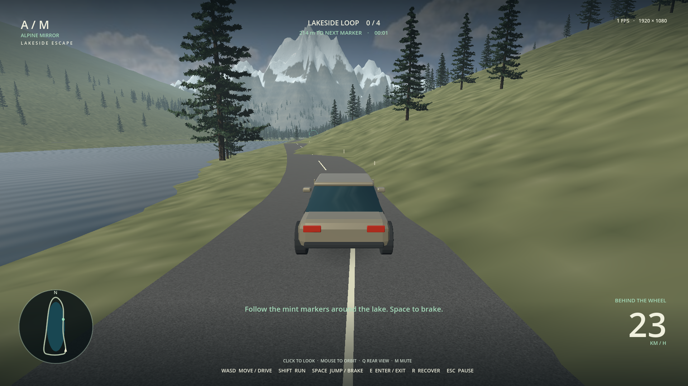

> **Current primary edition:** [Alpine: After Dark](../../engine/README.md) — custom Roadster/night runtime; root and `/alpine/` now target that edition. This document preserves historical release evidence, not current vehicle/deployment claims.

> **Latest release:** [licensed foliage, live planar water, sun shafts, and the playable custom Alpine framework](LIBRARY_RUNTIME_STATUS.md). Both game editions are published; the report below retains historical first-build evidence.

# Alpine Mirror game — playable prototype status

## Verdict

**Playable prototype: PASS WITH NOTES. Native 1080p rendering: VERIFIED. Requested 60 FPS: NOT MET in the available software-rendering test.**

This is not a production-ready 1080p60 game, not a finished GTA-scale world, and not a photorealism approval. A configured 60 FPS cap or 60 Hz physics does not satisfy the rendering requirement.

## Delivered

- Real **Godot 4.4.1 Web release**, running in the Arena live preview.
- The original Alpine mountain/valley heightfields adapted to a new roughly **965 m lakeside road loop**.
- Third-person walking/running/jumping; a follow camera with collision, orbit and rear view.
- A new, smoothly lofted Blender-authored touring car (12,588 triangles) with wheel arches, glazing/trim and four independent wheel pivots; one batched body mesh. Steering, acceleration, braking, collision and safe stopped-car entry/exit are preserved.
- Four scenic checkpoints, lap timer, locally saved best lap, pause, recovery and mute controls.
- Original 1,551 filtered tree placements: **110 near-road trees with spatial branch-card LODs and far billboard fallback**, **1,441 additional distant billboards**. Added 1,103 meadow tufts and 79 terrain-grounded granite rocks.
- Licensed photographic grass detail blended into original terrain materials and close-up normal detail. A CPU-captured static lake reflection replaces the old purely generic water look; this is not real-time planar reflection.
- Real multi-touch mobile UI: left stick, independent camera drag, enter/exit, throttle/reverse, jump/brake, run, pause/resume and recovery. Landscape guidance, cancellation release and explicit blur/visibility pause. Desktop keyboard controls remain.
- Single-threaded Web build includes mobile and desktop texture compression formats. Native 1920×1080 is retained, not silently reduced for phones.
- Balanced lighting by default; F2 toggles enhanced real-time shadows without lowering the native render resolution.
- Source project under `game/`, asset-generation/build/test tools under `tools/game/`, specialist usage trace in `docs/GAME_SKILL_USAGE.md`.
- Downloadable Web package: `.exports/Alpine_Mirror_Web.zip` (generated outside Git). It includes actual WASM/PCK runtime files, licenses and credits. Serve it over HTTP(S), not `file://`.

Published mobile/realism code revision: **`e91a6eb`**. The updated game is live on the same Pages URL.

## Verified evidence

| Gate | Result | Evidence |
|---|---|---|
| Real engine/toolchain | PASS | Official pinned Godot executable, matching Web templates, original upstream checksums and local transport hashes; `docs/GODOT_TOOLCHAIN_PROVENANCE.json` |
| Original cinematic preserved | PASS | `.blend` SHA-256 still `ef72c7f780af86dd6b89a07ae13aab9970d485ed782e835c19061c57b343dfc3`; no production script/workflow modified |
| Blender -> Godot asset import | PASS | Native heightfields resampled to 61,400 terrain triangles; CPU-baked original materials; GLB assets imported by actual Godot |
| Actual engine physics/state | **26/26 PASS locally and in CI** | `headless-validation.json`: original 14 keyboard/physics checks plus real viewport-local touch events, multi-touch ownership, camera orbit, movement, drive/brake/exit, pause/release, focus cleanup, recovery and instantiated detail |
| Desktop rendered browser gameplay — earlier baseline | **PASS (historical)** | `browser-validation.json`: real Chromium WebGL 2 / SwiftShader, actual keyboard input, 4.23 m recorded drive displacement, braking and subsequent exit, no console errors |
| Native 1080p | **VERIFIED** | Both Godot viewport and actual browser canvas are 1920 x 1080; render scale is 1.0; actual PNG captures below |
| GitHub Pages hosting | **LIVE** | [Play online](https://mhammedamazil-hub.github.io/Testrepo/). [Mobile update deployment](https://github.com/mhammedamazil-hub/Testrepo/actions/runs/42487951351) passed, including public HTTPS HTML/JS/audio-worklet checks, WASM/PCK binary headers and WASM MIME type. Pages source is Actions; the `github-pages` environment allows the active branch. Hosting checks do not certify rendered performance. |
| Source/evidence regression suite | **26/26 PASS locally and in CI** | Nine game/asset/mobile integrity tests plus the existing 17 audit/production/recovery checks |
| Rendered mobile touch gameplay | **15/15 PASS in emulation** | `mobile-browser-validation.json`: real Chromium CDP touch input, 932×430 phone viewport, native 1920×1080 canvas, simultaneous movement/look and throttle/steer, 4.32 m drive, brake/exit/pause/resume/cancel/focus handling, no console errors. Physical phones are not certified. |
| Clean public-runner import/test/export | **PASS** | [Mobile revision CI run](https://github.com/mhammedamazil-hub/Testrepo/actions/runs/42487951351): verified engine restore, clean asset import, 26 engine checks, 26 regression tests, actual Web export, downloadable artifact, Pages publication and public HTTPS runtime checks. Standard public-repository CPU runner; not a rendered FPS benchmark. |
| 60 FPS rendering | **NOT MET** | Earlier desktop software sample: 1 FPS / 1,814.5 ms P95 across 9 samples. The mobile-emulation functional run also reported 1 FPS, with a mixed-run P95 of 4,491 ms across 121 samples. These CPU SwiftShader runs are not controlled physical-phone benchmarks. Hardware-GPU performance remains untested. |
| Photoreal / full open-world completion | NOT APPROVED | Improved vehicle/environment, but character remains simplified; near trees use branch cards, distant trees are billboards; no traffic/NPC/combat/mission systems |

Headless tests are deliberately labeled `rendered: false` / `fps_benchmarked: false`. They prove game logic and physics behavior, not graphics speed.

### Latest mobile revision and actual engine images

- [Phone-sized Chromium browser capture](mobile-landscape-browser.png)
- [Mobile menu — native 1080p](mobile-menu-1080p.png)
- [On foot with touch controls — native 1080p](mobile-walking-1080p.png)
- [Driving with touch controls — native 1080p](mobile-driving-1080p.png)

These are **browser emulation**, not photographs of a physical phone. The full
functional touch run preceded the final asset-only foliage-atlas refinement;
final visual captures verify the refined art independently. Core input, physics
and lifecycle code are unchanged between those runs. Nearby trees now use
fine CPU-rendered needle-bough cards in 3D rather than the rejected opaque
shoot diamonds. Scene/character fidelity is still not photoreal approved.

### Earlier desktop baseline images

- [Menu — native 1080p](menu-1080p.png)
- [On foot — native 1080p](walking-1080p.png)
- [Driving — native 1080p](driving-1080p.png)

These are captures of the actual Godot Web canvas, not image-generated mockups or offline Blender stills.

## Optimization and failures retained

The first version used expensive per-glyph label shadows and enhanced world shadows. Approximately 598 menu / 661–707 gameplay draw calls were observed. The current balanced profile uses gradient UI backplates instead of text shadows and cheap contact blobs instead of global shadow maps. The observed counts fell to **54 menu / roughly 69–75 gameplay draw calls**, with roughly 73k–77k total rendered primitives in sampled views. This is an optimization result, **not** proof of 60 FPS.

The initial browser harness used fixed short sleeps and simulation-time telemetry; under extremely slow software graphics it sampled stale state. That failed result remains in `browser-validation-initial.json`. The corrected harness uses wall-clock telemetry and waits for actual motion/state transitions while keys remain held. Its successful result is separately retained in `browser-validation.json`.

Earlier empty tree-impostor and wheel-tangent issues were fixed before this build: update source transforms before bounds/camera placement, bypass inherited cinematic compositing for the asset capture, assert nonempty alpha, and triangulate n-gon caps before tangent export.

The optional embedded-bpy authoring cleanup workaround remains disclosed in `game/README.md` and the asset manifest. It is not part of the Godot gameplay runtime. Headless tests skip audio-device creation; graphical browser builds load audio normally. Audible playback was not subjectively reviewed in the sandbox.

## Mobile QA corrections retained

`mobile-initial-validation.json` retains the failed browser focus-loss test.
Godot's native focus notification alone did not catch the dispatched browser
blur event. The final implementation explicitly forwards blur/visibility state
from the HTML shell; the successful full touch run then verifies pause and
release. Touch menu mouse-emulation is explicitly enabled; ETC2/ASTC texture
import is enabled to satisfy the mobile compression export preset.

Thin-needle decimation initially erased the canopy. The first solid shoot-mass
replacement looked too geometric and was rejected visually. The final mesh uses
CPU-rendered fine-needle cards on 64 spatial boughs, with correctly applied mesh
origins and automatic simplification disabled for this budgeted near-tree LOD.

## Remaining acceptance work

1. Measure sustained native-1080p gameplay on an accessible real graphics device. The sandbox's CPU SwiftShader result cannot be advertised as 60 FPS or extrapolated into a hardware guarantee.
2. Continue CPU/GPU profiling with explicit frame-time and loading-stall budgets; keep native resolution visible and do not silently upscale a smaller render.
3. Improve close-up terrain detail, character deformation/animation, vehicle suspension/contact and environment art. The current car is arcade/kinematic, not a full wheel/suspension simulation.
4. Test on physical Android and iOS devices, including memory/loading, browser audio, thermal/sustained FPS and orientation changes. Broaden browser/device testing and longer route/edge-case playtesting before production approval.

The game is now a concrete, editable, playable starting point using the recommended pipeline. The 60 FPS requirement remains explicitly unfinished.
