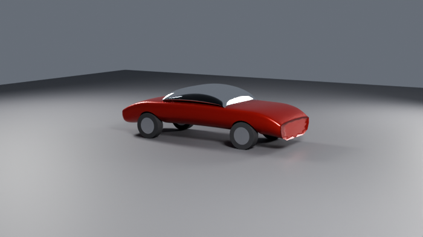

# Blender Skill System — Router

**Read this before any Blender operation.** Every task below has a skill; the rule for this
repository is *consult the skill first, then run Blender*. Skills exist because the failure
modes are known: wrong clip range, wrong framing aspect, boolean debris, exports that
silently contain nothing.

Environment this was built and tested on: **Blender 5.0.1 via the `bpy` pip wheel** (there is
no `blender` executable, so everything runs through `tools/bpy_run.py`), 2 CPU, 3.9 GB RAM,
no GPU, Cycles CPU only, **no internet access to asset sites** → all materials are
procedural.

---

## 1. The one rule

```
1. Identify the task stage (table below)          -> read that SKILL.md
2. Run the skill's script through tools/bpy_run.py
3. Read the JSON result AND the stated verification
4. Never report "it worked" from exit code 0 alone
```

If a task has no matching skill, read `WORKFLOW.md` and the closest vendored skill before
improvising. If a vendored skill's instructions conflict with what the installed build
does, the build wins — measure, then note the difference.

---

## 2. Stage → skill

| Stage | Skill | Script |
|---|---|---|
| Measure a reference, gate proportions | `local/reference-analysis` | `reference_report.py` |
| Grey-box blockout from real dimensions | `local/modeling-blockout` | `blockout.py` |
| Vehicle package: body, greenhouse, wheels | `local/modeling-automotive` | `car_body.py` |
| Topology audit, repair, panel lines, bevel stack | `local/modeling-detail` | `detail_pass.py` |
| Glass | `local/materials-glass` | `glass_materials.py` |
| Car paint (flake, coat, peel) | `local/materials-automotive-paint` | `car_paint.py` |
| Rubber, leather, carbon, metals, plastic | `local/materials-surfaces` | `surface_materials.py` |
| Wear, dust, grime, scratches | `local/materials-imperfections` | `imperfections.py` |
| Lighting rigs without HDRI | `local/lighting-studio` | `studio_lighting.py` |
| Framing, lens, DOF, ortho views | `local/camera-composition` | `compose.py` |
| How long a render will take | `local/render-optimize` | `render_plan.py` |
| Texel density / UV health | `local/uv-texel-audit` | `texel_audit.py` |
| Multi-view self-critique + contact sheet | `local/qa-render-review` | `review_render.py` |
| Prove an export is intact | `local/qa-export-verify` | `verify_export.py` |

Vendored knowledge skills (`vendor/blender-skills/`) are the *method* references for stages
this repository does not script: retopology, UV unwrapping, sculpting, geometry nodes,
texture baking, export pipelines, scene setup, time of day, game optimisation, pipeline
automation. Read the SKILL.md, run its scripts if they exist, otherwise use it as the
procedure and verify with the local QA skills.

---

## 3. Canonical commands

```bash
# environment / sanity
.venv/bin/python tools/bpy_run.py --selftest
.venv/bin/python tools/bpy_run.py --expr "import bpy; print(bpy.app.version_string)"

# run any skill script (the runner auto-inserts the '--' separator for skill args)
.venv/bin/python tools/bpy_run.py --blend scene.blend \
    skills/local/modeling-detail/scripts/detail_pass.py -- --objects Body --audit-only

# full test matrix (import tier + functional tier)
.venv/bin/python skills/tests/probe_skills.py --functional
```

`tools/bpy_run.py` exists because `bpy.app.binary_path` is empty in this environment: it
boots `bpy` in-process, applies the GL stub (`LD_LIBRARY_PATH=$PWD/.glstub`), optionally
loads a `.blend`, and collects the `@@JSON@@` result lines skills emit.

---

## 4. Skill anatomy

```
skills/local/<name>/
  SKILL.md                 when to use, procedure, CLI, verification done, honest limits
  scripts/<script>.py      headless bpy script, emits one @@JSON@@ line
skills/local/_shared/skill_common.py   shared helpers (see below)
skills/vendor/blender-skills/          MIT-licensed upstream skills (see vendor/ATTRIBUTION.md)
skills/tests/                          probe matrix + visual tests + report
```

`skill_common.py` provides: `parser/add_common/cli` (argparse + JSON emit + error capture),
`objects/bounds/aabb/dims`, `material/principled/set_input/node`, `camera/frame_objects/
fit_ortho/bounds`, `render`, `look_transform`, `tri_count`, `human`.

Two behaviours worth knowing because they were bugs first:
- `objects()` with no names returns **every visible mesh**, never "whatever is selected".
- `camera()` sets `clip_start/clip_end` from the subject distance, so millimetre-scale
  scenes are not clipped into an empty grey frame.

### Visual evidence from this build

`docs/img/car_blockout_34.png` — the parametric sedan blockout (700x394, Cycles, 32 spp,
11 s). `docs/img/material_grid.png` — 15-material contact sheet (1500x900, 16 spp, ~58 s).



---

## 5. Standard pipeline

```
reference-analysis ──> modeling-blockout / modeling-automotive
                            │
                            v
                     modeling-detail (audit -> fix -> bevel -> grooves)
                            │
                            v
        materials-* (+imperfections) -> uv-texel-audit
                            │
                            v
        camera-composition -> lighting-studio -> render-optimize
                            │
                            v
        qa-render-review (4 views, verdict) ──> qa-export-verify (reopen the file)
```

`WORKFLOW.md` has the full 19-step modelling procedure, the photorealism rules and the
self-critique loop that this pipeline implements.

---

## 6. Known limitations of this installation

Recorded so nobody promises something the environment cannot do:

| Limitation | Consequence |
|---|---|
| No `blender` executable | vendored `run_in_blender.py` cannot run; use `tools/bpy_run.py` |
| Stub `libGL` lacks `glXQueryExtension` | **Workbench and EEVEE renders crash**; vendored `review_shots.py` and `render_batch.py`'s EEVEE path are unusable. Use Cycles. |
| No internet except PyPI | no HDRI, no ambientCG/Poly Haven textures, no glTF sample assets; every surface is procedural |
| 2 cores / 3.9 GB RAM | plan renders with `render_optimize`; 1500x900 @16 spp ≈ 60 s |
| Procedural materials | flake, peel, weave, grime do not survive glTF/FBX export without baking |
| No GPU / no Cycles addon GPU path | OSL, GPU denoise, OptiX unavailable |
| Blender 5.0.1, not 5.2 | vendored code that assumes 5.2 APIs needs patching (one patch already applied to `gn_builder.py`) |
